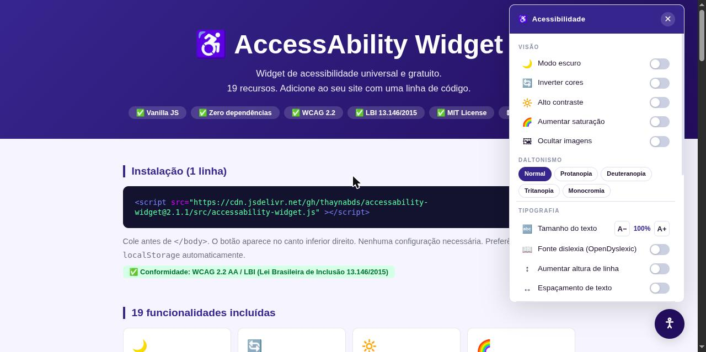

# ♿ AccessAbility Widget

Botão de acessibilidade para qualquer site: modo escuro, alto contraste, fonte para dislexia, filtros para daltonismo, leitura em voz alta e mais 13 recursos. **Grátis, sem cadastro, uma linha de código.**

[](https://www.npmjs.com/package/@thaynabds/accessability-widget)
[](https://thaynabds.github.io/accessability-widget/demo/)
[](LICENSE)
[](https://www.w3.org/WAI/WCAG22/quickref/)
[](https://www.planalto.gov.br/ccivil_03/_ato2015-2018/2015/lei/l13146.htm)

### ▶ [Ver a demonstração ao vivo](https://thaynabds.github.io/accessability-widget/demo/)



---

## 🚀 Começo rápido

Escolha **uma** opção, de acordo com o seu site.

### Opção 1 — Qualquer site (HTML, WordPress, Wix, Blogger…)

Cole esta linha logo antes de `</body>`:

```html
<script src="https://cdn.jsdelivr.net/gh/thaynabds/accessability-widget@2.1.3/src/accessability-widget.js"></script>
```

Pronto: o botão ♿ aparece no canto inferior direito.

<details>
<summary><b>Quer testar em 1 minuto?</b> Copie este arquivo completo</summary>

Crie um arquivo `teste.html`, cole o conteúdo abaixo e abra com o navegador (dois cliques):

```html
<!DOCTYPE html>
<html lang="pt-BR">
<head>
  <meta charset="UTF-8">
  <meta name="viewport" content="width=device-width, initial-scale=1.0">
  <title>Meu site</title>
</head>
<body>
  <h1>Olá!</h1>
  <p>Clique no botão ♿ no canto inferior direito.</p>
  <a href="https://github.com/thaynabds/accessability-widget">Um link</a>

  <script src="https://cdn.jsdelivr.net/gh/thaynabds/accessability-widget@2.1.3/src/accessability-widget.js"></script>
</body>
</html>
```

</details>

### Opção 2 — React (Vite, Create React App)

**1.** No terminal, na pasta do projeto:

```bash
npm install @thaynabds/accessability-widget
```

**2.** Em `src/App.jsx` (ou `App.tsx`):

```jsx
import { AccessAbilityWidget } from '@thaynabds/accessability-widget/react';

export default function App() {
  return (
    <>
      <AccessAbilityWidget />
      <h1>Meu app</h1>
    </>
  );
}
```

### Opção 3 — Next.js (App Router)

**1.** Instale:

```bash
npm install @thaynabds/accessability-widget
```

**2.** Em `app/layout.js` (ou `layout.tsx`):

```jsx
import { AccessAbilityWidget } from '@thaynabds/accessability-widget/react';

export default function RootLayout({ children }) {
  return (
    <html lang="pt-BR">
      <body>
        <AccessAbilityWidget />
        {children}
      </body>
    </html>
  );
}
```

### Opção 4 — Vue, Svelte, Angular ou JavaScript com bundler

```bash
npm install @thaynabds/accessability-widget
```

No arquivo principal (`main.js`, `main.ts`…):

```js
import { init } from '@thaynabds/accessability-widget';

init();
```

> Pelo npm o widget só aparece quando você chama `init()` ou usa `<AccessAbilityWidget />`. Pela tag `<script>` (opção 1) ele aparece sozinho.

---

## 🧑‍🦯 Como o visitante usa

| Ação | Como |
|---|---|
| Abrir o painel | Clique ou toque no botão ♿ — ou `Alt + A` no teclado |
| Fechar | Botão ✕, clique fora do painel ou `Esc` |
| Mudar o botão de lugar | Arraste o botão; a posição fica salva |
| Voltar ao normal | **↺ Restaurar padrões**, no fim do painel |

As escolhas ficam salvas no navegador da pessoa (`localStorage`) e valem na próxima visita. Nada é enviado para servidor nenhum.

---

## ✨ Recursos

| | Recurso | Ajuda quem tem |
|---|---|---|
| 🌙 | Modo escuro | Fotofobia, fadiga ocular |
| 🔄 | Inverter cores | Baixa visão |
| 🔆 | Alto contraste | Baixa visão |
| 🌈 | Aumentar saturação | Baixa percepção de cores |
| 🖼 | Ocultar imagens | Dificuldade de concentração |
| 🎨 | Filtros para daltonismo (protanopia, deuteranopia, tritanopia, monocromia) | Daltonismo |
| 🔤 | Tamanho do texto (80% a 140%) | Baixa visão, idosos |
| 📖 | Fonte para dislexia (OpenDyslexic) | Dislexia |
| ↕ | Mais espaço entre linhas | Dislexia, TDAH |
| ↔ | Mais espaço entre letras e palavras | Dislexia |
| 🔗 | Destacar links | Baixa visão, deficiência cognitiva |
| 📑 | Destacar títulos | Quem lê por escaneamento |
| ⏸ | Pausar animações | Epilepsia, TDAH, vertigem |
| 🎬 | Pausar vídeos | Epilepsia, concentração |
| 🖱 | Cursor grande | Tremor, baixa visão |
| 🎯 | Destacar o foco do teclado | Quem navega sem mouse |
| 📏 | Guia de leitura (faixa que segue o mouse) | Dislexia, TDAH |
| 🔊 | Ler em voz alta o texto selecionado | Cegueira, baixa visão |
| 💾 | Lembrar as preferências | Todos |

<details>
<summary>Como cada recurso funciona por dentro</summary>

| Recurso | Implementação |
|---|---|
| Modo escuro | `filter: invert(1) hue-rotate(180deg)` no `<body>`, com imagens e vídeos preservados; combinável com os outros filtros |
| Inverter cores | `filter: invert(1)` |
| Alto contraste | `filter: contrast(2.4)` |
| Saturação | `filter: saturate(3) contrast(1.1)` |
| Ocultar imagens | `visibility: hidden` em `img`, `picture` e `[role=img]` |
| Daltonismo | SVG `feColorMatrix`; monocromia com `grayscale(1)` |
| Tamanho do texto | `font-size` no `<html>`, de 80% a 140% em passos de 10% |
| Fonte dislexia | OpenDyslexic via jsDelivr |
| Linhas / espaçamento | `line-height: 2.2`; `letter-spacing: .14em` e `word-spacing: .2em` |
| Links / títulos | Fundo amarelo e sublinhado em `<a>`; borda lateral em `h1`–`h6` |
| Pausar animações | `animation-play-state: paused` e `transition-duration: 0ms` |
| Pausar vídeos | `.pause()` em todos os `<video>`, inclusive os adicionados depois (`MutationObserver`) |
| Cursor grande | Cursor SVG via `cursor: url(...)` |
| Foco do teclado | `outline: 3px solid #ffcc00` em `:focus` |
| Guia de leitura | Overlay com faixa transparente que acompanha o mouse |
| Voz | Web Speech API (`SpeechSynthesisUtterance`) |

</details>

---

## ❓ Problemas comuns

- **O botão não aparece (tag `<script>`)** — confira se a linha está **antes de `</body>`** e se a URL está completa, com `@2.1.3`.
- **O botão não aparece (npm)** — pelo npm é preciso chamar `init()` ou renderizar `<AccessAbilityWidget />`.
- **Erro no Next.js / SSR** — use `@thaynabds/accessability-widget/react`; o módulo já tem `'use client'` e não faz nada no servidor.
- **Atualizei, mas continua a versão antiga** — use sempre a URL com versão (`@2.1.3`). Com `@latest` o jsDelivr pode demorar até 7 dias para atualizar o cache.

---

## 🛠 Controlar pelo código (opcional)

### Em React

```jsx
import { AccessAbilityWidget, useAccessAbilityWidget } from '@thaynabds/accessability-widget/react';

function BotaoModoEscuro() {
  const { prefs, applyPrefs } = useAccessAbilityWidget();
  if (!prefs) return null; // ainda carregando (e no servidor)
  return (
    <button onClick={() => applyPrefs({ darkMode: !prefs.darkMode })}>
      Modo escuro: {prefs.darkMode ? 'ligado' : 'desligado'}
    </button>
  );
}

export default function App() {
  return (
    <>
      <AccessAbilityWidget onChange={(prefs) => console.log('mudou', prefs)} />
      <BotaoModoEscuro />
    </>
  );
}
```

- `<AccessAbilityWidget prefs={{ fontSize: 2 }} onChange={fn} />` — `prefs` aplica preferências; `onChange` recebe cada mudança.
- `useAccessAbilityWidget()` devolve `{ prefs, applyPrefs, reset, open, close, speak }`.
- Renderize `<AccessAbilityWidget />` **uma vez**, perto da raiz. Funciona com React 16.8+, StrictMode e Next.js.

### Em JavaScript

Pela tag `<script>`, use `window.AccessAbilityWidget`. Pelo npm, importe as mesmas funções: `import { open, applyPrefs } from '@thaynabds/accessability-widget'`.

```js
const w = window.AccessAbilityWidget;

w.open();                                   // abre o painel
w.close();                                  // fecha
w.applyPrefs({ darkMode: true, fontSize: 2 }); // aplica preferências
w.getPrefs();                               // lê as preferências atuais
w.reset();                                  // volta ao padrão
w.speak('Bem-vindo!');                      // lê um texto em voz alta
const parar = w.subscribe((prefs) => console.log(prefs)); // avisa a cada mudança
w.destroy();                                // remove o widget da página
w.init();                                   // coloca de volta
```

<details>
<summary>Detalhes da API</summary>

- `window.A11yWidget` é o mesmo objeto (nome antigo, mantido por compatibilidade).
- As funções podem ser chamadas a qualquer momento, inclusive antes de a página terminar de carregar.
- Valores inválidos em `applyPrefs` são ignorados: chaves desconhecidas, tipos errados, `fontSize` fora de -2 a 4 (-2 = 80%, 4 = 140%) ou filtro de daltonismo inexistente.
- Preferências disponíveis: `darkMode`, `invertColors`, `highContrast`, `saturationBoost`, `colorBlind` (`none`, `protanopia`, `deuteranopia`, `tritanopia`, `monochromia`), `fontSize`, `dyslexicFont`, `lineHeight`, `textSpacing`, `highlightLinks`, `highlightHeadings`, `hideImages`, `pauseAnimations`, `pauseVideos`, `bigCursor`, `focusVisible`, `readingGuide`.
- Tipos TypeScript incluídos no pacote npm.

</details>

---

## ⚖️ Conformidade

- **WCAG 2.2** (W3C) — os recursos de contraste, texto e navegação apoiam critérios de nível AA.
- **LBI — Lei Brasileira de Inclusão 13.146/2015** — amplia o acesso digital, conforme o Art. 63.

> Widgets de acessibilidade **complementam, mas não substituem** um HTML acessível (semântica, ARIA, texto alternativo em imagens).

---

## 🔐 Backend opcional (sincronizar preferências entre aparelhos)

A pasta `api/` tem uma API REST em **Spring Boot 3.3 + Spring Security + JWT** para guardar as preferências de cada usuário após login. Não é necessária para usar o widget.

```bash
cd api && ./mvnw spring-boot:run
```

Swagger em `http://localhost:8080/swagger-ui.html`.

<details>
<summary>Endpoints, variáveis e deploy</summary>

Endpoints:
- `POST /api/auth/register` — cadastro
- `POST /api/auth/login` — retorna o token JWT
- `GET  /api/preferences` — lê as preferências (requer JWT)
- `PUT  /api/preferences` — salva as preferências (requer JWT)

Variáveis de ambiente:
- `JWT_SECRET` — chave dos tokens, com pelo menos 32 bytes. Sem ela, a API gera uma chave aleatória a cada inicialização (bom para testar; os tokens deixam de valer ao reiniciar). Não há chave fixa no código.
- `CORS_ORIGINS` — sites autorizados, separados por vírgula.
- `PORT` — porta HTTP (padrão `8080`).

Deploy gratuito: [Render](https://render.com) → **New > Blueprint** → escolha este repositório. O `render.yaml` monta o `api/Dockerfile` e gera o `JWT_SECRET` sozinho.

Stack: Java 21, Spring Boot 3.3, Spring Data JPA, H2, JJWT 0.12.6, BCrypt, OpenAPI.

</details>

---

## 👩‍💻 Para quem quer contribuir

```bash
git clone https://github.com/thaynabds/accessability-widget.git
cd accessability-widget
npm install
npm test                      # testes do widget, do pacote e do React
python3 -m http.server 5500   # demo em http://localhost:5500/demo/
```

<details>
<summary>Testes, versões e publicação</summary>

- Testes no navegador: com o servidor acima, abra `http://localhost:5500/tests/widget.test.html` (de preferência com emulação de celular no DevTools). A página mostra `WIDGET_TESTS_OK` quando tudo passa.
- Testes da API: `cd api && ./mvnw test`.
- A demo é publicada no GitHub Pages a cada push na `main` (`.github/workflows/pages.yml`).
- Nova versão: atualize `version` em `package.json`, `index.cjs` e `src/accessability-widget.js`; troque a URL `@2.1.3` no README e na demo; crie a tag (`git tag v2.1.4 && git push origin v2.1.4`) e publique com `npm publish`.

</details>

---

## 📄 Licença

[MIT](LICENSE) — use, modifique e distribua à vontade.
